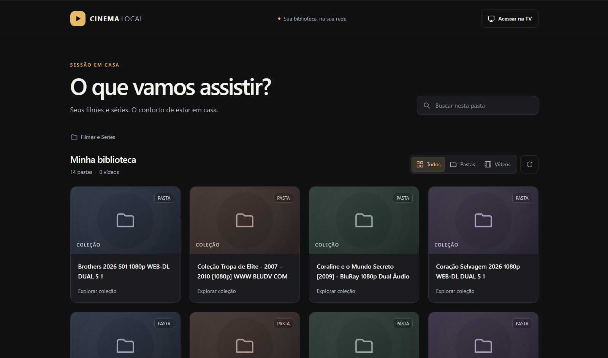
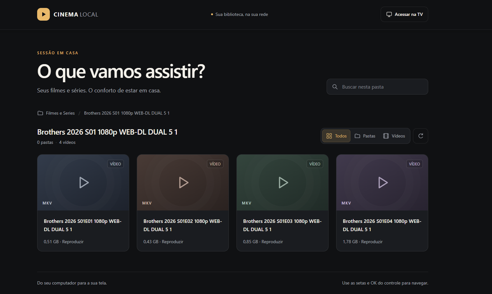
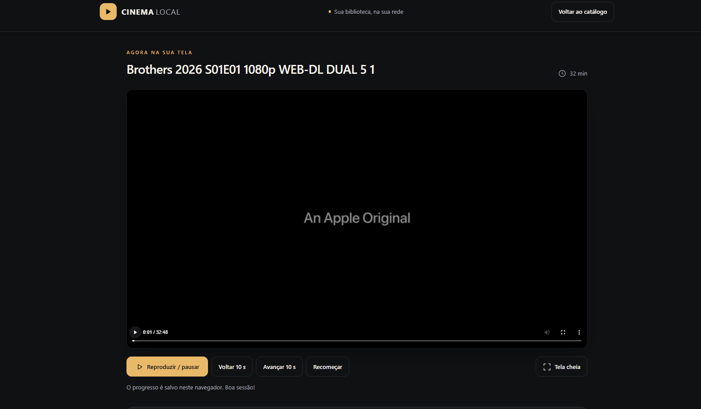
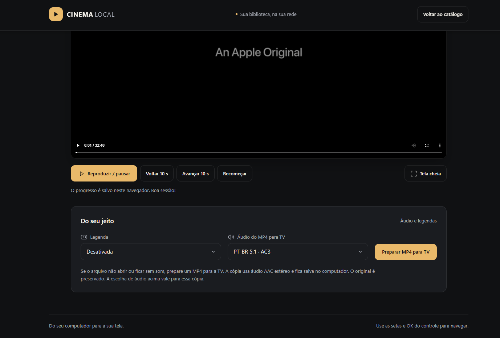
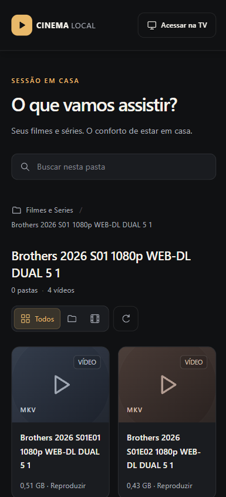
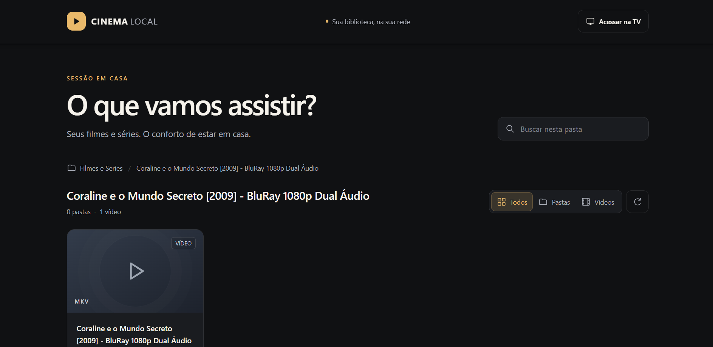

# Cinema Local

Servidor de filmes e séries para assistir pelo navegador do computador ou da TV, usando os arquivos de uma pasta da sua máquina.

**Versão 0.1.0** · Laravel 13 · PHP 8.3+ · Blade · Tailwind CSS 4 · Alpine.js

## Recursos

- Navegação por pastas e coleções, com busca e filtros.
- Player com avanço, retrocesso, tela cheia e retomada no mesmo navegador.
- Legendas SRT/VTT externas e legendas de texto embutidas no vídeo.
- Preparação de MP4 H.264/AAC com escolha de áudio, progresso e cancelamento.
- Reutilização das cópias preparadas, sem alterar os vídeos originais.
- Navegação por teclado ou controle remoto.

## Instalação e execução

Siga o guia do seu sistema:

| Sistema | Guia |
| --- | --- |
| Windows | [Laragon, Apache e atalhos de início/encerramento](docs/instalacao/windows.md) |
| Linux | [Apache, PHP e fila Laravel](docs/instalacao/linux.md) |
| macOS | [Homebrew, Apache e PHP-FPM](docs/instalacao/macos.md) |

Requisitos: PHP 8.3+, Composer 2, Node.js 24 LTS, FFmpeg/FFprobe e Apache 2.4 com PHP ou PHP-FPM. O banco é SQLite, via extensão `pdo_sqlite`.

No Windows, os atalhos `iniciar.cmd` e `parar.cmd` gerenciam uma instância dedicada do Apache do Laragon e um worker. Os guias Linux e macOS descrevem a configuração manual desses processos.

A porta padrão é **80**. Com o servidor ligado, abra [http://localhost](http://localhost) no computador. Na TV, use o IP mostrado em **Acessar na TV**. Os dois dispositivos precisam estar na mesma rede e o computador deve permanecer ligado.

## Configuração

Na primeira instalação, copie `.env.example` para `.env`, gere `APP_KEY` e aplique as migrações, conforme o guia do sistema.

```dotenv
APP_URL=http://localhost
APP_DEBUG=false
MEDIA_PORT=80
MEDIA_DIRECTORY="/caminho/para/Filmes e Series"
FFMPEG_BINARY=/caminho/para/ffmpeg
FFPROBE_BINARY=/caminho/para/ffprobe
QUEUE_CONNECTION=database
DB_QUEUE_RETRY_AFTER=21660
SESSION_DRIVER=file
CACHE_STORE=file
```

`MEDIA_DIRECTORY` deve ser um caminho absoluto. Se estiver vazia, será usada a pasta `storage/app/private/library`. No Windows, use barras `/` e coloque caminhos com espaços entre aspas.

`FFMPEG_BINARY` e `FFPROBE_BINARY` aceitam caminhos absolutos ou os nomes dos executáveis disponíveis no PATH do processo. `MEDIA_ADVERTISED_IP` permite definir o IP anunciado à TV; `MEDIA_ALLOWED_HOSTS` aceita domínios locais adicionais, separados por vírgula.

`MEDIA_PORT` configura o helper Windows. Quando o Apache é configurado manualmente, a porta também precisa ser ajustada no servidor web. Depois de editar o `.env`, execute `php artisan config:clear` e reinicie o servidor e o worker.

## Preparação para TV

Se um vídeo não abrir ou ficar sem som, escolha uma faixa de áudio e clique em **Preparar MP4 para TV**. A conversão depende do worker:

```sh
php artisan queue:work --sleep=1 --tries=1 --timeout=21630 --memory=256
```

Vídeo H.264 de 8 bits até 1080p é copiado quando possível. Os demais formatos são convertidos para H.264 até 1080p, com quatro threads. O áudio da cópia usa AAC estéreo.

As cópias ficam em `storage/app/private/converted`, ocupam espaço no disco do projeto e não têm limpeza automática. Para cancelar a preparação ativa e encerrar o worker:

```sh
php artisan cinema:stop-worker
```

## Desenvolvimento

Depois de preparar o ambiente:

```sh
composer validate --strict
php artisan test
npm run build
```

Os testes usam arquivos temporários e um vídeo sintético. Para executar o teste de conversão, configure FFmpeg e FFprobe no `.env` ou no PATH.

Durante a edição do frontend, `npm run dev` inicia o Vite. Para acessar pela TV, encerre o Vite e use `npm run build`, servindo os assets pelo mesmo endereço do Laravel.

O servidor embutido do PHP é uma alternativa para desenvolvimento no Linux/macOS. Para streaming no Windows, use Apache: o servidor embutido atende uma única requisição por vez nesse sistema.

### Estrutura

| Pasta | Conteúdo |
| --- | --- |
| `app/Http` | Controllers, validação e restrição de rede |
| `app/Services` | Biblioteca, metadados, legendas, streaming e conversão |
| `app/Jobs` | Processamento em segundo plano |
| `resources/views` | Layout e páginas Blade |
| `resources/js` | Player, filtros e navegação com Alpine.js |
| `resources/css` | Tema e componentes Tailwind |
| `scripts/windows` | Gerenciamento do Apache e do worker |
| `docs/instalacao` | Guias por sistema operacional |
| `docs/screenshots` | Capturas de tela |

Veja [CONTRIBUTING.md](CONTRIBUTING.md) para as convenções de contribuição e [CHANGELOG.md](CHANGELOG.md) para o histórico de versões.

## Capturas de tela

### Catálogo



### Navegação por pastas



### Player



### Preparação para TV



### Celular



### TV



## Limitações

- A reprodução direta depende dos codecs aceitos pelo navegador da TV. A extensão MKV ou MP4 não garante compatibilidade.
- O progresso fica no navegador do dispositivo; não há sincronização entre TV e computador.
- Legendas de imagem PGS/DVD não são extraídas.
- Conversão HDR não inclui tone mapping dedicado e pode alterar as cores.
- O serviço não tem login e foi feito para uma rede local de confiança. Dispositivos que conheçam o endereço podem consultar a biblioteca e solicitar preparações.

Se a TV não alcançar o computador, confira o IP, o firewall e o isolamento da rede Wi-Fi. Os erros da aplicação ficam em `storage/logs/laravel.log`; no Windows, os logs do Apache e do worker ficam em `storage/framework/cinema-server`.

## Licença

[MIT](LICENSE).
